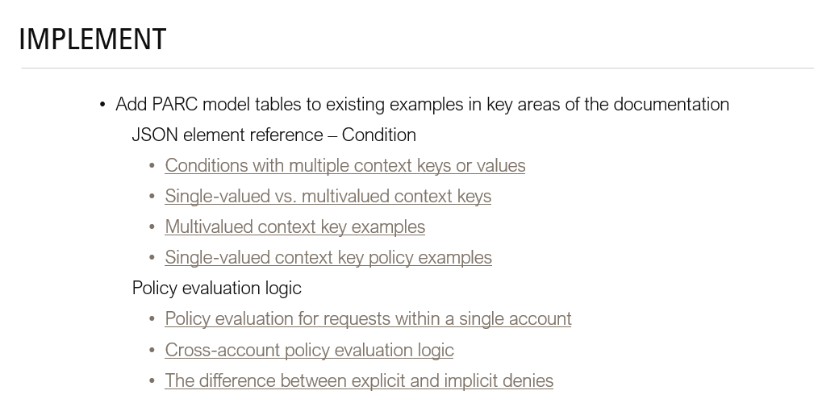

# Condition operators: From documentation gap to implementation

This case study follows a documentation improvement project for AWS Identity and Access Management (IAM), from the first customer signal to the published pages.

## About this sample

The project details are as follows:

- **Audience:** AWS customers who write IAM policies, from new users to security engineers
- **Problem:** Customers had difficulty understanding how condition operators in a policy match the values in an authorization request
- **My role:** Created the plan, wrote the draft, worked with subject matter experts (SMEs) to verify accuracy, and published the rewrite
- **Collaborators:** Service team engineers and product managers
- **Verification:** Tested permissions in a test environment while drafting, and then reviewed and revised the draft with an SME
- **Tools and standards:** IAM APIs and a docs-as-code workflow
- **Outcome:** Addressed 134 undocumented combinations of prefixes, operators, and suffixes, and introduced the PARC (principal, action, resource, condition) model across key areas of the IAM documentation

## Research

The project started when a widely read AWS blogger published a third-party reference for IAM condition operators, which showed that customers were looking outside the AWS documentation for this information. To measure the gap, I reviewed the existing documentation and recent customer feedback:

- **Documentation coverage:** 134 combinations of prefixes, operators, and suffixes weren't documented
- **Customer feedback:** 6 backlogged feedback tickets, and 28 tickets closed in the previous 12 months

I grouped the tickets by theme: questions about how specific operators work, the logic of operators with multiple values, presentation issues, service-specific issues, and cross-account and advanced policy scenarios. I then reviewed the findings with an SME, which led to the key finding: some customers didn't understand the relationship between a policy and the request it evaluates. The PARC model shows that relationship directly.

## Plan

For my plan, I focused on how to better meet customers where they are by first addressing foundational issues like the PARC model. As part of the plan, I outlined a standard for policy evaluation examples and identified key areas where a more robust evaluation example would be most impactful.

## Implement

I added a visual model and examples that break the request down into its JSON elements, and added use case examples across the policy pages.

## Published pages

The following AWS documentation pages include the results of this project:

- [IAM JSON policy elements: Condition operators](https://docs.aws.amazon.com/IAM/latest/UserGuide/reference_policies_elements_condition_operators.html)
- [Multivalued context key examples](https://docs.aws.amazon.com/IAM/latest/UserGuide/reference_policies_condition_examples-multi-valued-context-keys.html)
- [Single-valued context key examples](https://docs.aws.amazon.com/IAM/latest/UserGuide/reference_policies_condition_examples-single-valued-context-keys.html)

!!! note
    These pages are maintained by AWS and may have changed since I worked on them.
