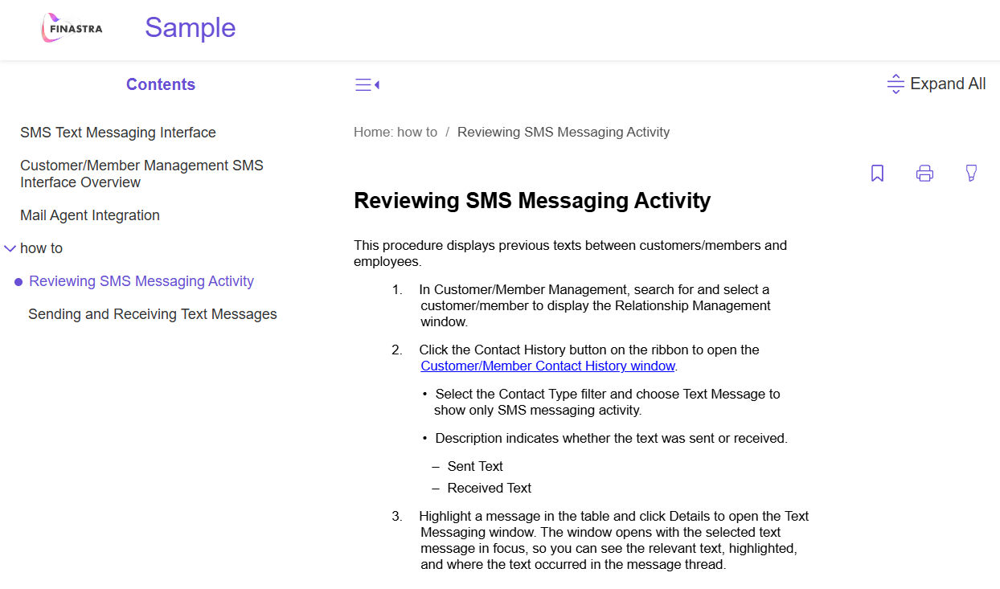

# RoboHelp help system

This sample is a working help system I built in Adobe RoboHelp. It opens in a new tab with its own navigation and search.

## About this sample

The project details are as follows:

- **Audience:** Phoenix retail banking customers
- **My role:** Designed the help system and wrote the content as lead writer
- **Topic types:** Overview topics, how-to topics, and reference topics for individual windows
- **Features:** A table of contents, full-text search, and a custom stylesheet
- **Tools and standards:** Adobe RoboHelp

## View the help system

The help system opens in a new tab. The following screenshot shows its home page.

<a href="help/index.htm" target="_blank" rel="noopener">Launch the help system</a>

{ width="500" }
