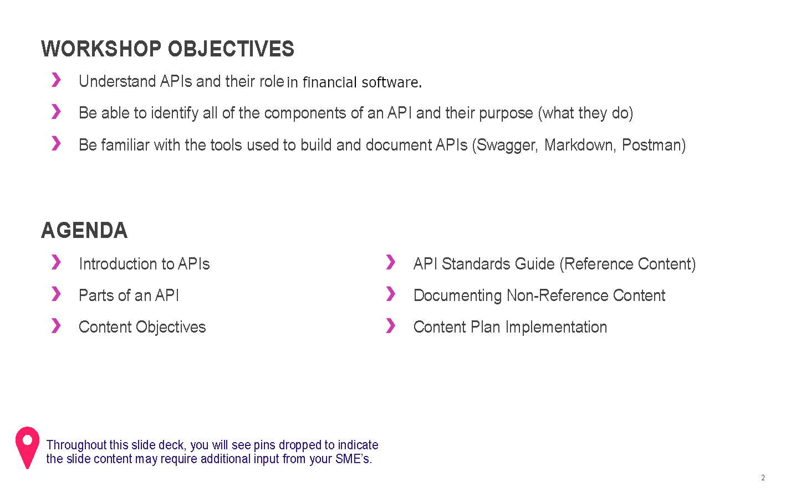
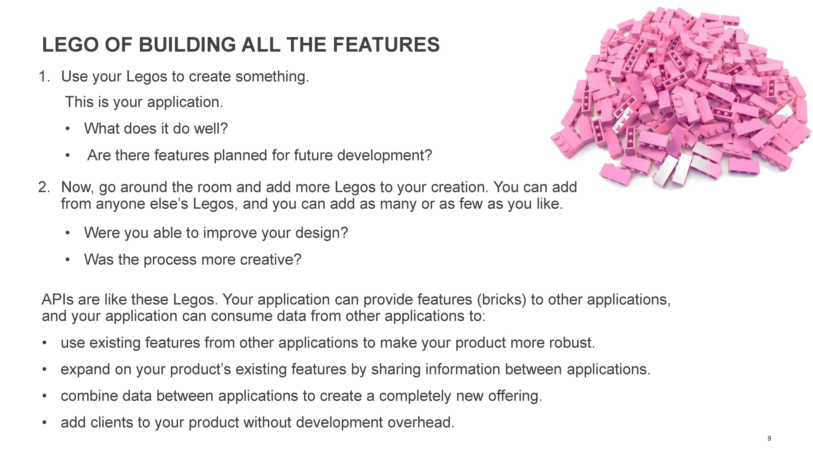
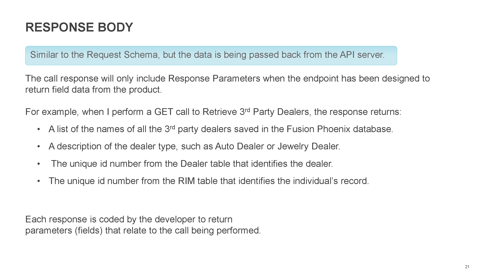
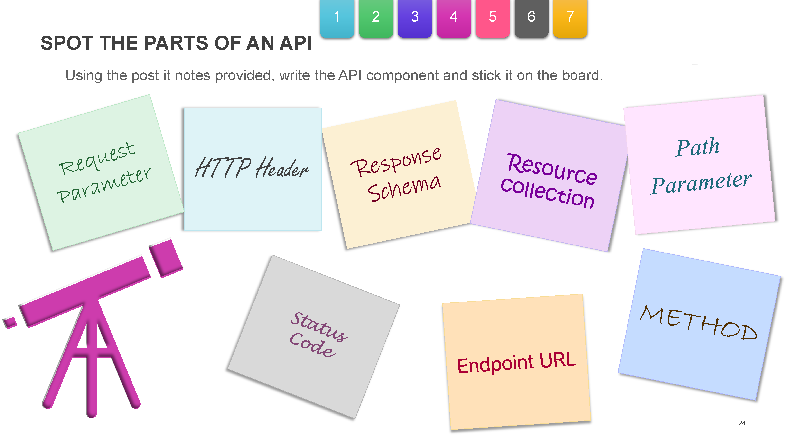
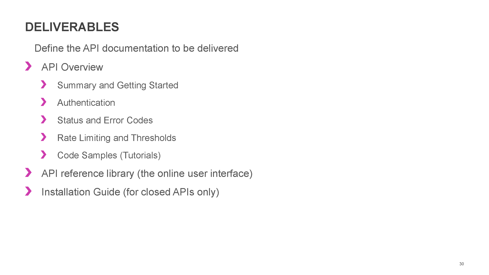
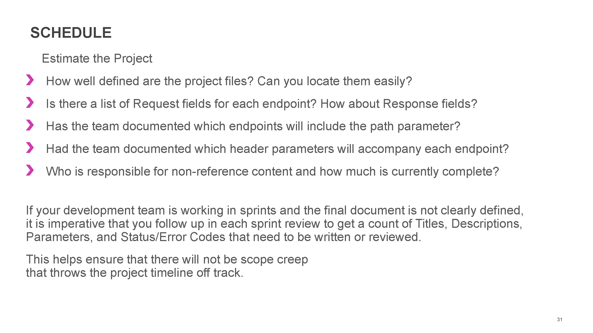
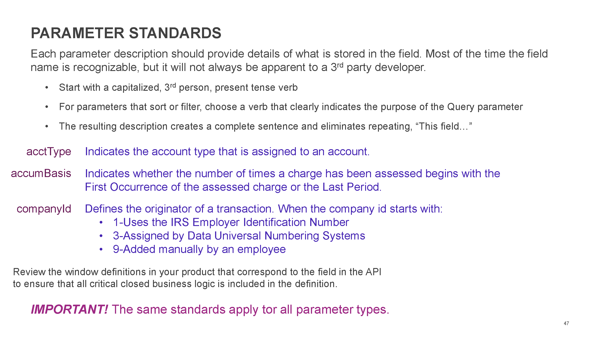
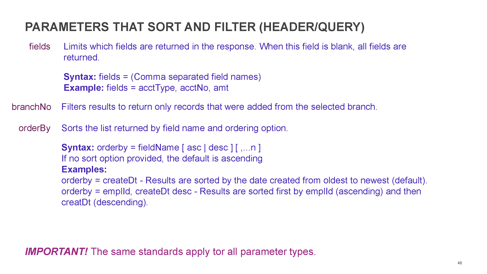

# Documenting APIs workshop

This sample is a workshop I created and delivered to technical writers and product analysts moving into API documentation.

## About this sample

The project details are as follows:

- **Audience:** Technical writers and product analysts who were new to API documentation
- **Objectives:** Understand APIs and their role in the product, identify the components of an API and their purpose, and become familiar with the tools used to build and document APIs (Swagger, Markdown, and Postman)
- **My role:** Designed and presented the workshop
- **Delivery:** A two-day, in-person workshop that brought together writers from all company locations, with me as the trainer
- **Outcome:** Writers returned to their teams ready to contribute to creating and editing documentation for their products' API initiatives

## Selected slides

The following slides follow the workshop from its objectives through API concepts, hands-on activities, project planning, and documentation standards:

- [{ .slide-thumb }](../../assets/images/workshop1.png) **Objectives and agenda**: Lists the workshop objectives: understanding APIs, identifying the components of an API, and becoming familiar with Swagger, Markdown, and Postman.
- [{ .slide-thumb }](../../assets/images/workshop2.png) **Introducing APIs activity**: Participants build an application from bricks, and then improve it with bricks from other participants. The slide explains that APIs let applications share features and data, combine data into new offerings, and add clients without development overhead.
- [{ .slide-thumb }](../../assets/images/workshop3.png) **Response body**: Explains how the response body passes data back from the API server, with an example of the fields a GET call returns for a list of third-party dealers.
- [{ .slide-thumb }](../../assets/images/workshop4.png) **Parts of an API activity**: Participants identify the components of an API, such as the endpoint URL, method, path and request parameters, HTTP header, status code, resource collection, and response schema.
- [{ .slide-thumb }](../../assets/images/workshop5.png) **Deliverables**: Helps writers define deliverables before the project starts, including the API overview, the API reference library, and an installation guide for closed APIs.
- [{ .slide-thumb }](../../assets/images/workshop6.png) **Schedule and estimation**: Lists questions for estimating the project, such as whether request and response fields are listed for each endpoint.
- [{ .slide-thumb }](../../assets/images/workshop7.png) **Parameter standards**: Shows how writers apply the parameter standards from the API style guide, with examples for each rule.
- [{ .slide-thumb }](../../assets/images/workshop8.png) **Sort and filter parameters**: Gives syntax and examples for parameters that sort and filter results.

## Related sample

The workshop teaches the standards in the [API style guide and standards manual](../api/api-style-guide.md).
